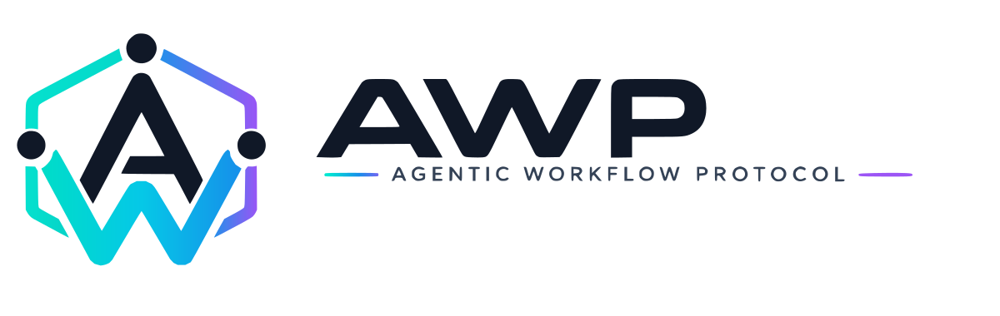

<p align="center">
  <picture>
    <source media="(prefers-color-scheme: dark)" srcset="https://raw.githubusercontent.com/agenticworkflowprotocol/agenticworkflowprotocol.org/main/site/public/brand/awp-wordmark-horizontal-dark.svg">
    
  </picture>
</p>

# AWP - Agentic Workflow Protocol

**An open, declarative standard for defining, governing, executing and auditing agentic workflows.**

> MCP connects agents to tools. A2A connects agents to agents. AWP defines how agents work.

> **Status: draft / alpha.** The specification has two draft versions: `v1alpha1` and `v1alpha2`
> (`v1alpha1` plus step iteration, `forEach`). Both are working drafts: fields, semantics and
> conformance profiles may change incompatibly before `v1`. Do not rely on them for production
> interoperability yet.

## What AWP is

AWP is a **specification, not a platform**. It describes, in a vendor-neutral and machine-readable
way:

- **what** an agentic workflow does (agents, tools, steps, triggers, inputs),
- **within which limits** it may run (budgets, resources, tool permissions, environments),
- **under which governance** it runs (ownership, data classification, data residency, model
  governance, human approval, risk levels, separation of duties, supply-chain integrity),
- **what it leaves behind** (audit events, decision traces, reproducibility records).

AWP complements existing protocols instead of replacing them:

| Protocol | Scope |
| -------- | ----- |
| MCP      | Agents ↔ tools and resources |
| A2A      | Agent ↔ agent communication |
| AWP      | Definition, governance, execution and audit of agentic workflows |

A minimal manifest:

```yaml
apiVersion: awp.agenticworkflowprotocol.org/v1alpha1
kind: Workflow
metadata:
  name: vulnerability-fixer
  version: 0.1.0
  owner:
    team: security-team
  classification: internal
spec:
  triggers:
    - type: manual
  budget:
    maxCostUsd: 2.00
    maxSteps: 30
    maxDuration: 15m
  mcpServers:
    - name: github
      transport: streamable-http
      url: https://mcp.example.com/github
  agents:
    - id: fixer
      model:
        provider: ollama
        name: qwen3
      tools:
        - type: mcp
          server: github
          tools: [get_file_contents, push_files]
  workflow:
    - id: fix
      agent: fixer
    - id: test
      type: command
      command: npm test
      dependsOn: [fix]
  permissions:
    default: deny
    tools:
      github.get_file_contents:
        allow: true
      github.push_files:
        allow: true
      shell.execute:
        allow: true
```

## Compliance

AWP provides machine-readable governance primitives that can help organizations implement and
enforce their own compliance requirements. AWP itself does not make any system compliant with any
law or regulation. Compliance depends on the implementation, organizational controls and
applicable regulatory requirements.

## Validate, view and edit a manifest

- **Editor and viewer:** [editor.agenticworkflowprotocol.org](https://editor.agenticworkflowprotocol.org) shows a manifest as step
  graph, agents, tools and permissions, approvals and budgets, next to a YAML editor with live
  validation. [awp-editor](https://github.com/agenticworkflowprotocol/awp-editor) provides both as Web Components (`<awp-viewer>`,
  `<awp-editor>`) to embed in applications and documentation, like Swagger UI for OpenAPI.
- **Online:** [validator.agenticworkflowprotocol.org](https://validator.agenticworkflowprotocol.org) checks a manifest in the browser
  (YAML rules, JSON Schema, semantic rules, per conformance profile); nothing is uploaded.
- **CLI and library:** [awp-validator](https://github.com/agenticworkflowprotocol/awp-validator) provides `awp validate` and a library for Node.js
  and the browser, to validate manifests in CI or inside a runtime. It is built on the schema and
  conformance suite of this repository, pinned by commit.
- **In this repository:** `node conformance/awp-check.mjs check <file>` (see
  [conformance/README.md](conformance/README.md)).

## Implementations

| Implementation | Status |
| -------------- | ------ |
| - | No implementation has published a conformance statement yet. |

**Call for implementations:** AWP is not tied to any runtime. If you build a runtime, validator or
tool that implements AWP, open an issue or pull request to be listed here. Listing requires a
public statement of the supported conformance profiles.

## Repository layout

| Path | Content |
| ---- | ------- |
| `spec/` | Normative specification text (planned for `v1alpha1`) |
| `docs/` | Concept documentation and website plan |
| `site/` | Website (Astro Starlight), see [site/README.md](site/README.md) |
| `CNAME` | Custom domain for GitHub Pages (`agenticworkflowprotocol.org`) |

## Contributing

Contributions are welcome. Please read [CONTRIBUTING.md](CONTRIBUTING.md) (DCO sign-off,
Conventional Commits) and the [Code of Conduct](CODE_OF_CONDUCT.md). How decisions are made is
described in [GOVERNANCE.md](GOVERNANCE.md). Security issues: see [SECURITY.md](SECURITY.md).

Questions and ideas: GitHub Issues and Discussions. Contact: info@agenticworkflowprotocol.org

## License

- Specification text and documentation: [CC BY 4.0](LICENSE-SPEC)
- Code, schemas, conformance tests and tooling: [Apache-2.0](LICENSE)
